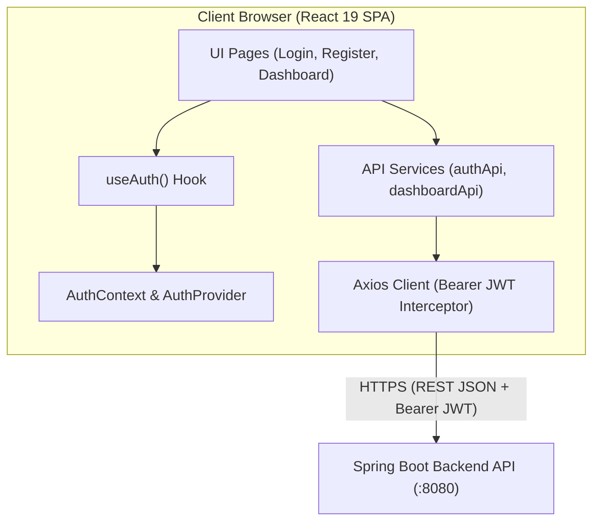

# JobPulse Frontend 💼⚡

<div align="center">
  
  
  
  
  
</div>

<br />

## 📌 Overview

**JobPulse Frontend** is a modern Single Page Application (SPA) designed to help software engineers and professionals track, organize, and analyze their job application pipeline. 

It serves as the dedicated web client for the [JobPulse Spring Boot REST API](https://github.com/psh0x00/JobPulse) — connecting a reactive, accessible user interface to a high-performance backend powered by Java 21, Spring Boot, Redis, and PostgreSQL.

> 💡 **Development Status:** The project is actively developed following structured agile milestones (Sprint 1: Foundation in progress). It follows strict enterprise-grade software engineering principles, automated quality checks, and client-side security standards.

---

## 🏗 Architecture & Engineering Highlights

The client is built with a decoupled, domain-driven structure to maximize scalability, testability, and maintainability:

* **Strict TypeScript Type Safety:** Dedicated DTO interfaces (`src/types/`) directly mirror backend payloads (`LoginRequest`, `RegisterRequest`, `DashboardStatsResponse`), compiled with strict `verbatimModuleSyntax`.
* **Isolated Service Layer:** UI components never execute raw HTTP requests; all data access is encapsulated in dedicated service modules (`src/api/`).
* **Automated JWT Interceptor:** An Axios request interceptor seamlessly attaches the `Authorization: Bearer <token>` header to all outgoing requests once authenticated.
* **Client-Side Route Guarding:** A declarative `ProtectedRoute` interceptor blocks unauthenticated access to private views and handles session redirection.
* **Accessibility-First Design (WCAG 2.1 AA):** All forms enforce semantic HTML, proper `<label htmlFor="...">` associations, visual keyboard focus indicators, and accessible alert roles (`role="alert"`).
* **Hot Module Replacement (HMR) Optimization:** Decoupled Context definitions and Provider components to guarantee clean Vite Fast Refresh cycles with zero state corruption.



---

## 🛠 Tech Stack

| Technology | Version | Purpose |
|---|---|---|
| **React** | `19.x` | Core UI library using modern functional components and hooks |
| **TypeScript** | `6.x` | Static type checking, strict null checks, type-only module imports |
| **Vite** | `8.x` | Next-generation bundler with instant HMR and optimized production builds |
| **Tailwind CSS** | `4.x` | Utility-first styling configured via CSS `@theme` tokens |
| **React Router** | `8.x` | Declarative client-side routing, protected layouts, and redirects |
| **Axios** | `1.x` | Promise-based HTTP client with request/response interceptors |
| **ESLint** | `9.x` | Code quality enforcement with React Hooks & Fast Refresh validation |

---

## 🚀 Roadmap & Sprint Progress

Development is tracked through structured GitHub Milestones:

### 🟢 Sprint 1: Foundation (In Progress — ~90%)
- [x] Scaffold Vite + React 19 + TypeScript + Tailwind CSS v4 environment
- [x] Configure Axios client with automated Bearer JWT request interceptor (`axiosClient`)
- [x] Implement global authentication state and storage persistence (`AuthContext` & `AuthProvider`)
- [x] Build accessible Login page with client validation and loading states (`/login`)
- [x] Build accessible Registration page with input constraint validation (`/register`)
- [x] Implement client-side route guard (`ProtectedRoute`) and centralized routing (`AppRoutes`)
- [x] Build real-time Dashboard statistics cards consuming backend Redis cache (`GET /api/v1/dashboard/stats`)
- [ ] Implement Application Shell layout (Sidebar and Top Navigation)

### 🟡 Sprint 2: Core Application Tracking
- [ ] Applications Kanban board and Data Table views with filtering and pagination
- [ ] Create & Edit Application modals with company and recruiter associations
- [ ] Application status lifecycle updates (`APPLIED` $\rightarrow$ `INTERVIEW` $\rightarrow$ `OFFER` $\rightarrow$ `REJECTED`)
- [ ] Recruiter and company contacts directory

### ⚪ Sprint 3: Visual Analytics, Polish & Cloud Deployment
- [ ] Pipeline funnel analytics and application rate charts (Recharts)
- [ ] Comprehensive unit and integration test suite (Vitest + React Testing Library)
- [ ] Automated CI/CD workflow deploying on Vercel connected to Railway cloud backend

---

## 💻 Local Setup & Development

### Prerequisites
* **Node.js** $\ge$ `20.x`
* **npm** $\ge$ `10.x`
* Companion backend: [JobPulse Spring Boot API](https://github.com/psh0x00/JobPulse) running on `http://localhost:8080` (or Railway cloud instance)

### 1. Clone & Install
```bash
git clone https://github.com/psh0x00/JobPulse-frontend.git
cd JobPulse-frontend
npm install
```

### 2. Environment Configuration
Create a `.env` file from the provided example:
```bash
cp .env.example .env
```

Ensure `.env` points to your backend instance:
```env
VITE_API_URL=http://localhost:8080
```

### 3. Run Development Server
```bash
npm run dev
```
Open **[http://localhost:5173](http://localhost:5173)** in your browser.

### 4. Quality & Build Checks
```bash
# Typecheck & generate production bundle
npm run build

# Run static analysis and lint rules
npm run lint
```

---

## 🔗 Related Repositories

* 🖥️ **Backend API:** [psh0x00/JobPulse](https://github.com/psh0x00/JobPulse) — Spring Boot 4 REST API with Java 21, Spring Security 7, Redis caching, PostgreSQL, Docker, and GitHub Actions CI.
